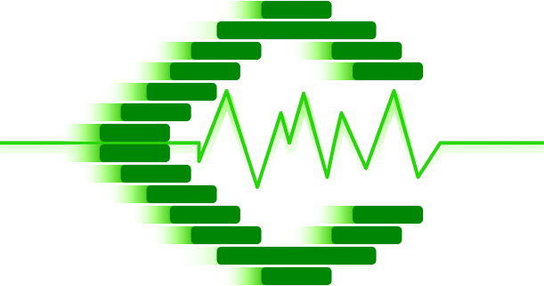

# Crypto Static Rate

<div align="center">
    <a href="https://github.com/FetchServe/Rate" title="Crypto Static Rate">
        
    </a>
</div>

---

:bar_chart: JSON Format : [Latest Update](https://github.com/FetchServe/Rate/raw/main/rateStatic.json 'rate static free api crypto')

:white_check_mark: Direct : `https://github.com/FetchServe/Rate/raw/main/rateStatic.json`

:zap: Source : KuCoin public API &nbsp;|&nbsp; Pairs : `23` &nbsp;|&nbsp; Updated : `2026-11-01 21:00:56 UTC`

---

| Pair | Last Price | High 24h | Low 24h | Change 24h |
|:-----|-----------:|---------:|--------:|-----------:|
| `ADA-USDT` | `0.1923` | `0.1945` | `0.1906` | `-0.20%` |
| `ALGO-USDT` | `0.0938` | `0.0958` | `0.093` | `-1.36%` |
| `ATOM-USDT` | `1.463` | `1.5183` | `1.4538` | `-2.55%` |
| `AVAX-USDT` | `8.682` | `9.037` | `8.516` | `+1.41%` |
| `BCH-USDT` | `281.69` | `287.55` | `279.6` | `-1.68%` |
| `BTC-USDT` | `77912.8` | `78225` | `77406.7` | `+0.50%` |
| `CAKE-USDT` | `1.909` | `1.978` | `1.897` | `-1.13%` |
| `DASH-USDT` | `47.71` | `49.52` | `47.39` | `-0.47%` |
| `DGB-USDT` | `0.003163` | `0.003251` | `0.003116` | `-0.53%` |
| `DOGE-USDT` | `0.07533` | `0.07625` | `0.07493` | `-0.51%` |
| `DOT-USDT` | `0.9512` | `0.959` | `0.9398` | `+0.39%` |
| `ETC-USDT` | `7.1191` | `7.1963` | `7.0772` | `+0.29%` |
| `ETH-USDT` | `2264.55` | `2277.86` | `2250.65` | `+0.50%` |
| `LINK-USDT` | `11.4115` | `11.9162` | `11.3551` | `-3.31%` |
| `LTC-USDT` | `55.46` | `56.4` | `54.96` | `-0.52%` |
| `QTUM-USDT` | `0.765` | `0.777` | `0.765` | `-1.03%` |
| `SHIB-USDT` | `0.000004686` | `0.000004719` | `0.000004655` | `+0.04%` |
| `SOL-USDT` | `94.39` | `96.19` | `93.66` | `-1.29%` |
| `TRX-USDT` | `0.3127` | `0.3157` | `0.3008` | `+2.92%` |
| `UNI-USDT` | `7.1699` | `7.4032` | `6.9947` | `+0.93%` |
| `XLM-USDT` | `0.1678` | `0.1709` | `0.1663` | `-1.06%` |
| `XMR-USDT` | `596.24` | `610.44` | `591.18` | `-0.75%` |
| `XRP-USDT` | `1.24985` | `1.25979` | `1.24278` | `+0.00%` |

---

## JSON Schema

Each record in `rateStatic.json`:

```json
{
    "symbol": "BTC-USDT",
    "lastPrice": "63042.8",
    "highPrice24h": "63500",
    "lowPrice24h": "62480.1",
    "changeRate": "0.0049",
    "lastUpdated": "2026-11-01 21:00:56 UTC"
}
```

`changeRate` is a fraction of the 24h open price, not a percentage: `0.0049` means `+0.49%`.

---

Hit Cryptocurrency Rate Reporter and Ticker (Auto Update)


---

## Example Code in Various Languages

We have provided example code for utilizing the **FetchServe Rate API** in different programming languages. You can find these examples in the following pages:

- [C Example Code](https://github.com/FetchServe/Rate/wiki/C-Example-Code)
- [C++ Example Code](https://github.com/FetchServe/Rate/wiki/C-Plus-Plus-Example-Code)
- [Go Example Code](https://github.com/FetchServe/Rate/wiki/GO-Example-Code)
- [Haskell Example Code](https://github.com/FetchServe/Rate/wiki/Haskell-Example-Code)
- [JavaScript Example Code](https://github.com/FetchServe/Rate/wiki/JavaScript-Example-Code)
- [PHP Example Code](https://github.com/FetchServe/Rate/wiki/PHP-Example-Code)
- [PowerShell Example Code](https://github.com/FetchServe/Rate/wiki/Powershell-Example-Code)
- [Python Example Code](https://github.com/FetchServe/Rate/wiki/Python-Example-Code)
- [Rust Example Code](https://github.com/FetchServe/Rate/wiki/Rust-Example-Code)
- [Shell Example Code](https://github.com/FetchServe/Rate/wiki/Shell-Example-Code)
- [TypeScript Example Code](https://github.com/FetchServe/Rate/wiki/Typescript-Example-Code)

Each of these links will take you to the corresponding wiki page, where you'll find detailed instructions and examples for using the API in your preferred language.

If you'd like to contribute or have any questions, feel free to check the [Issues](https://github.com/FetchServe/Rate/issues) section.

